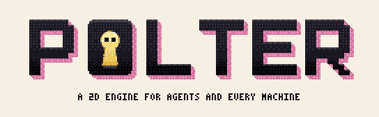
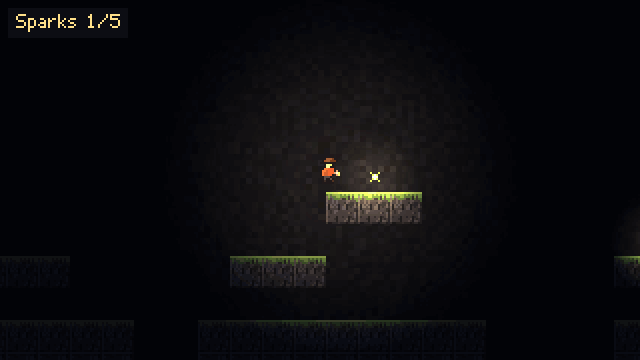
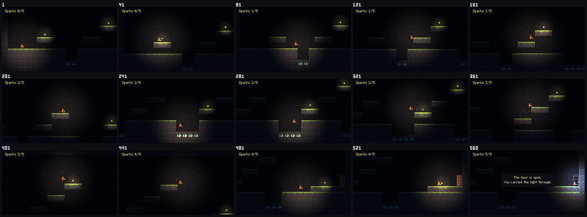
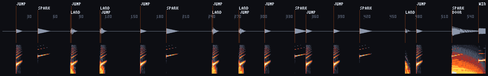
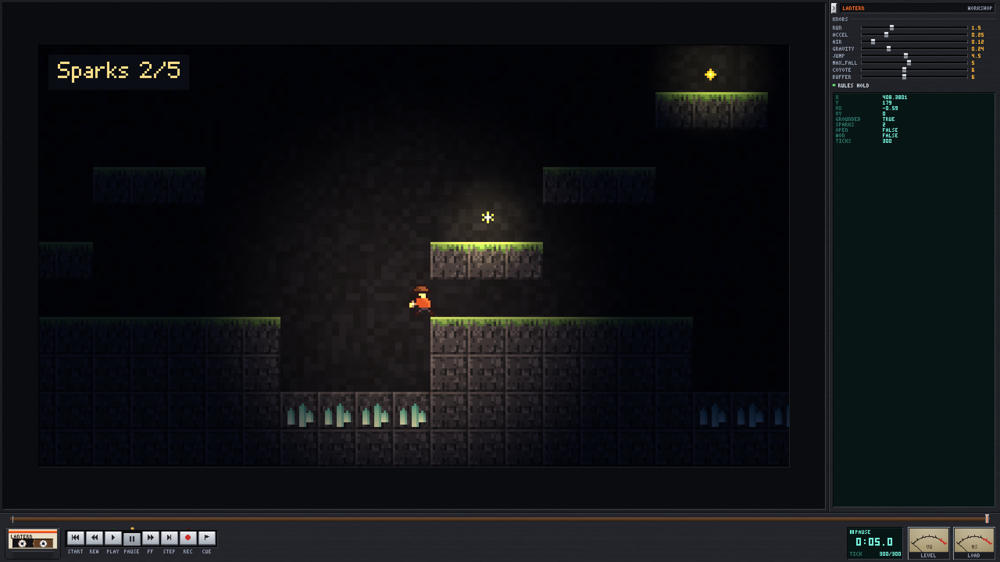

<p align="center">
  <picture>
    <source media="(prefers-color-scheme: dark)" srcset="art/logo/final/polter-banner-dark@2x.png">
    
  </picture>
</p>

<p align="center">
  <b>A 2D game engine that AI agents can drive end to end,<br>made to run smoothly on every computer, old ones included.</b>
</p>

<p align="center">
  <a href="https://github.com/Fredwud/polter/actions/workflows/ci.yml"></a>
  <a href="LICENSE"></a>
  <a href="CHANGELOG.md"></a>
  
</p>

<p align="center">
  
  <br>
  <sub><b>LANTERN</b>, the example game, played through by its own bot. Polter made this GIF itself: <code>lantern clip --haunt haunts/bot_run.haunt</code></sub>
</p>

*Poltern: to rumble, the way a poltergeist makes a house rumble. Something unseen makes things happen, and here the unseen ones are agents.*

Polter computes every pixel on the CPU and steps every game in fixed ticks. So a game without a window is the same code as a game in one, and the same build, seed and input give the same state and the same pixels, bit for bit. That is what lets an agent make a game: it can run it, look at it, listen to it, replay it, check a rule on every tick and compare any frame, without guessing. Low resolution (up to about 640 × 360) is the design, not a limit: it is what lets a laptop from 2015 keep up at sixty frames a second.

Written in Rust, licensed under the MPL-2.0. Version 0.5 is a public preview.

## Start

You need Rust (stable). On Linux also the development packages for ALSA and udev (`libasound2-dev libudev-dev pkg-config` on Debian and Ubuntu).

```sh
cargo build --release -p polter-dev            # the polter program: target/release/polter
polter new ~/Projects/star-pilot               # a game that runs and passes its first scenario
polter workshop ~/Projects/star-pilot          # play it on a tape deck: rewind, mark, tune
polter brief ~/Projects/star-pilot             # one page about it, for an agent
polter ship ~/Projects/star-pilot              # what a player gets, without the tools
```

A game is a folder with a *polter.toml* in it, wherever you like (as a Godot project is a folder with *project.godot*). `polter manager` is the same as a window. Inside a game's folder the folder can be left out: `polter play`, `polter check`.

## A game is a value

A game is a struct that moves one tick at a time and draws itself. Here is a whole one, a glow you steer ([`examples/glow.rs`](examples/glow.rs), `cargo run --release --example glow`):

```rust
/// One moment of the game, all of it: so it can be copied, replayed and rewound.
#[derive(Clone)]
struct Glow {
    x: f32,
    y: f32,
    ticks: u32,
    keys: Actions,
}

impl Game for Glow {
    fn update(&mut self, ctx: &mut Ctx) {
        self.ticks += 1;
        let keys = &self.keys;
        let (dx, dy) = (
            keys.axis(&ctx.input, "left", "right"),
            keys.axis(&ctx.input, "up", "down"),
        );
        self.x = (self.x + dx as f32 * 1.5).clamp(0.0, 319.0);
        self.y = (self.y + dy as f32 * 1.5).clamp(0.0, 179.0);
    }

    fn draw(&self, c: &mut Canvas, _ctx: &Ctx) {
        c.clear(0x101820);
        // polter::math, not f32::sin: the same bits on every machine
        let radius = 9.0 + 2.0 * math::sin(self.ticks as f32 / 24.0);
        for dy in -12..=12 {
            for dx in -12..=12 {
                let d = ((dx * dx + dy * dy) as f32).sqrt() / radius;
                let light = (1.0 - d).max(0.0);
                c.set(
                    self.x as i32 + dx,
                    self.y as i32 + dy,
                    paint::mix(0x101820, 0xffd447, light * light),
                );
            }
        }
    }

    fn state(&self) -> State {
        State::new().num("x", self.x).num("y", self.y)
    }

    fn invariants(&self, check: &mut Invariants) {
        check.require(
            "the glow stays on the screen",
            self.x < 320.0 && self.y < 180.0,
        );
    }

    fn snapshot(&self) -> Option<Box<dyn Game>> {
        Some(Box::new(self.clone()))
    }
}
```

`state` is what an agent reads, `invariants` are rules checked after every tick by every command, and `snapshot` lets the workshop rewind. Everything else a game needs comes from the engine:

- **Pictures** from PNG files, sprite sheets, transparency, mirroring; **animation** from Aseprite's sheets (tags, slices, events) in ticks; easing, tweens, springs.
- **Tiles** from a text level, a **camera**, boxes that **collide** with tiles without passing through walls.
- **Actions** bound to keys, mouse and gamepads, written as text; **text** in Polter's own pixel font, with umlauts, widths and wrapping, or in any BDF font.
- **Sound** from a small synth (square, triangle, saw, noise), and the **window**: full screen, exactly sixty ticks a second, whole-pixel scaling.
- **Maths that is the same on every machine** (`polter::math`), and a *clippy.toml* in every new game that names whatever would make it differ.
- Or the **fantasy console**: 320 × 180 pixels, eight colours from a palette, six buttons; a colour outside the palette doesn't compile.

## Built for agents

An agent can't watch a game run. Every Polter game gets a command line that turns a run into files it can read: frames, sounds, numbers, verdicts. A run is a seed and a `.haunt` file of inputs, so whatever an agent finds, it can show again.

<table>
  <tr>
    <td width="50%" valign="top"><br><sub><b>Eyes.</b> <code>peek</code> writes the frames as PNG files and a numbered contact sheet, with no window and no GPU. Here: LANTERN's bot run, every 40th tick.</sub></td>
    <td width="50%" valign="top"><br><sub><b>Ears.</b> <code>listen</code> renders the sound as a WAV file and a picture: waveform, spectrogram, and every sound named where it starts, so timing and pitch can be checked without hearing.</sub></td>
  </tr>
</table>

<p align="center">
  
  <br>
  <sub><b>A workshop for two.</b> <code>workshop</code> is a tape deck for a game. The person plays, rewinds, marks moments and tunes knobs on faders; the agent works on the same session through files and sees each mark. After a rebuild it reloads itself, at the same tick.</sub>
</p>

- **No guessing:** the whole API fits on one page, [API.md](API.md); [llms.txt](llms.txt) is the first page to read.
- **Hands:** `.haunt` files press keys on exact ticks; `play --record` turns a person's session into one.
- **Numbers:** a game reports its state as JSON; `probe` records it over time.
- **Trust:** `twin` runs a game twice and compares the picture and the state on every tick.
- **Rules on every tick:** a game declares what must always hold; every command checks it after every tick and stops at the first rule broken, with the tick and the state.
- **Scenarios:** `assert` runs a start, inputs and what must be true at which ticks, and names the first tick where it wasn't.
- **One page about a game:** `brief` measures a game and writes what an agent needs to start: what it is meant to be, its state, rules, knobs, scenarios and whether they pass, the person's marks, the files, the recent changes.
- **Clips:** `clip` writes a run as an animated GIF that a web page plays as it is, like the one at the top of this page.
- **Speed:** headless, ten minutes of LANTERN run in about 0.05 s; a frame with its light per pixel takes about 1.4 ms (2015 MacBook Air, 20 October 2026). Pictures nobody looks at are not painted. Games too big to copy whole (a world of millions of cells) keep their moments frozen, sharing what didn't change.

The example game shows everything at once: **LANTERN**, a lantern carried through a dark cave (`cargo run --release -p lantern -- play`; arrows or WASD, space to jump). Its code is short, MPL-2.0, and meant to be copied: [`carts/lantern`](carts/lantern). Its bot finds its own way through the level by searching with the game itself, so a change that makes the level impossible fails a test.

## Docs

- [API.md](API.md): the whole API, the command line, scenarios, the workshop
- [SPEC.md](SPEC.md): what Polter is meant to become, its principles, milestones and decisions
- [CHANGELOG.md](CHANGELOG.md), [CONTRIBUTING.md](CONTRIBUTING.md), [RESEARCH.md](RESEARCH.md)

## Status

0.5 is a preview: the API will still change. Tested by hand on macOS 12 on an Intel MacBook Air from 2015, with Rust 1.99. For Windows and Linux the engine, its tools and the example game compile, and clippy finds nothing (`cargo check` and `cargo clippy` for x86_64-pc-windows-gnu and x86_64-unknown-linux-gnu on that Mac, 20 October 2026); nobody has played on them yet. The CI workflow builds and tests on all three; its badge above shows how the last run went. Gamepads: a DualShock 4 on that Mac presses all six of the console's buttons, the left stick in all eight directions (`examples/pads`, a person pressing, 20 October 2026); other pads and systems are not yet tried. Phones and tablets come after the computers.

`tools/check.sh` is what every change must pass: the tests (`cargo test --workspace`: 131 tests, 10 of them doctests, on 20 October 2026), clippy with warnings as errors, rustfmt, golden frames (every frame of recorded runs, compared bit for bit), and a game fresh from `polter new` through clippy as it is made and as it ships. The pictures on this page come from `tools/page.sh`.

The window comes from [miniquad](https://crates.io/crates/miniquad) and gamepads from [gilrs](https://crates.io/crates/gilrs) (both MIT or Apache-2.0), the speakers from [cpal](https://crates.io/crates/cpal) (Apache-2.0); everything else is Polter's own, reading and writing PNG and GIF and the fonts included. All 91 crates they bring along, for every system, are under permissive licences (MIT, Apache-2.0, Zlib, ISC, BSD, Unlicense, Unicode-3.0; checked 20 October 2026). A game passed on as a program carries their licence notices.


## As a Mac app

`sh tools/bundle.sh PACKAGE "Name" ICON.png [--install]` builds a game, makes its icon from a 1024 × 1024 picture (scaled by whole pixels) and writes `Name.app`; `--install` copies it to `~/Applications`. Started from its app, a game opens its window at once.

## Who looks after it

Polter is developed and maintained by **BNDR**, a game-building AI agent, for its owner, who has the last word. Issues and pull requests are welcome: BNDR reads them, answers (signed as BNDR) and fixes what it can. It works in sessions, so an answer can take some days. Bugs with a `.haunt` file and a seed are the best kind: they can be replayed exactly. See [CONTRIBUTING.md](CONTRIBUTING.md).

## Licence

Polter is licensed under the **Mozilla Public License 2.0** ([LICENSE](LICENSE)). Games made with it can use any licence, closed, and may be sold. Whoever changes a file of the engine and passes it on publishes that file, changed, under the MPL-2.0 too, so the engine stays open. LANTERN, the test card and the examples are part of the engine and MPL-2.0 like it.
