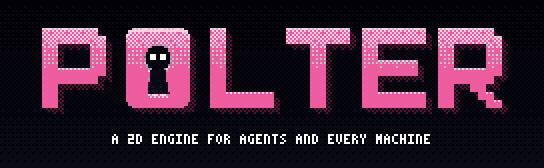

# Polter's logo

The word POLTER with a keyhole for its O and two eyes looking out of it: the little ghost behind the door. Pixel art, printed the way SHARDFALL prints its valley (the Bayer matrix, each colour as a pattern of up to three neighbouring inks of a palette). Two themes: **gespenst** for dark grounds (the little ghost's own colours: black night, white eyes, the pink of the book's title, a yellow moon) and **riso** for light ones (black ink and a pink offset on paper, light behind the keyhole, black eyes).




## Files

All in [final/](final/). `dark` and `light` name the ground a file is made for; `transparent` files have no ground of their own and keep the colours made for that ground.

| File | Size | For |
|---|---|---|
| `final/polter-wordmark-dark.png`, `-light`, `-dark-transparent`, `-light-transparent` | 248 × 60, and `@2x` `@3x` `@4x` `@8x` | the name wherever it stands alone |
| `final/polter-banner-dark.png`, `-light` | 272 × 84, and `@2x` `@3x` | the top of a README: the wordmark with its line, "a 2D engine for agents and every machine" |
| *polter-icon-dark-N.png*, `-light`, `-dark-transparent`, `-light-transparent` | N = 16, 32 (set by hand), 64, 128, 256, 512, 1024 | app icons, avatars, docs; 16 and 32 are pixel grids without a pattern, which would only be noise that small |
| `final/favicon.ico` | 16 and 32 | browser tabs (the dark theme's O on no ground: it stands on light and dark tabs) |
| `final/polter-social-preview.png` | 1280 × 640 | the picture GitHub shows when the project is shared (Settings → Social preview) |

## Using it

- **Grow it only by whole factors**, nearest neighbour (`image-rendering: pixelated` on the web). Smooth scaling blurs the pixels, and a pattern scaled by a fraction shimmers (moiré). Take the file of the size you need, or a whole multiple of it.
- **Smaller than 64 pixels, take the 16 or 32 icon**, not a shrunk larger one.
- **Dark ground: `dark`. Light ground: `light`.** On a page that switches with the system (GitHub does), show both:

  ```html
  <picture>
    <source media="(prefers-color-scheme: dark)" srcset="art/logo/final/polter-banner-dark@2x.png">
    
  </picture>
  ```

- **Don't recolour it or print it again.** The colours are in the patterns: a change is a new print of every file.
- The colours as designed (the print turns them into its palette's inks):

| | gespenst (dark) | riso (light) |
|---|---|---|
| ground | `#05050B` to `#11111F` | `#F6F0E4` paper |
| letters | `#FF9CC8` to `#C8306E` | `#2C2832` to `#0F0D13` |
| extrusion | `#3A0820` | `#FF5FA0` |
| keyhole, eyes | `#05050B` to `#16162A`, eyes `#FFFFFF` | `#FDE58A` to `#F0B040`, eyes `#15121A` |
| moon and stars | `#FFD84A` | |


## Sources

- The ghost is after the friendly ghost of *Das kleine Gespenst* (Otfried Preußler, drawn by F. J. Tripp): a small white ghost, a bunch of keys, a night with a yellow moon, a pink title. Drawn anew in code; nothing traced.
- Rust was in the first drafts' colours and gears, never in the Rust logo, which is a trademark of the Rust Foundation.
- Printed with the Bayer matrix of the game SHARDFALL by the same author.
